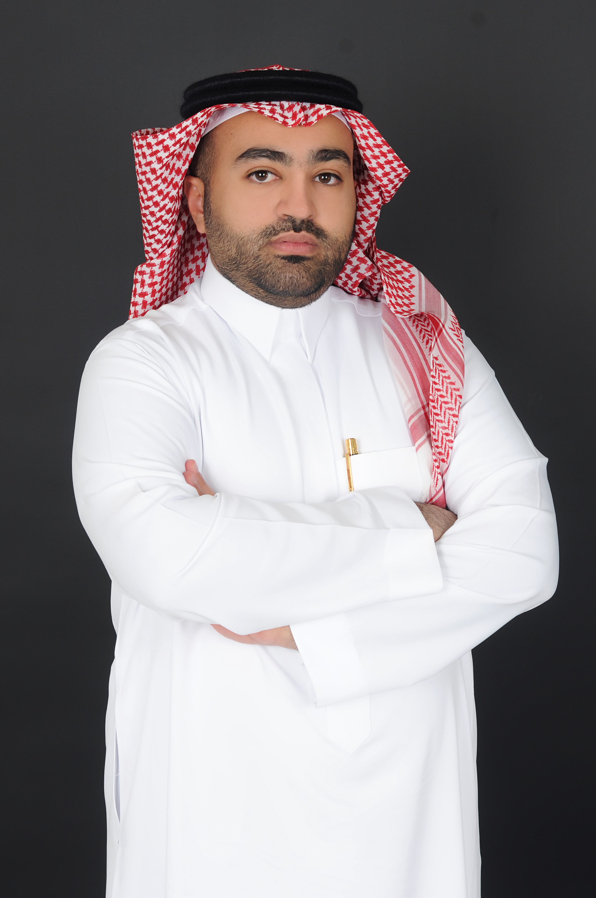

تبريد الرياض

<section class="hero-section">

</section>

<section class="intro-grid">

<h2>الهيلم فهد العجمي</h2>

مهندس مدني 
طالب دراسات عليا في التحليلات المكانية الحضرية

مهندس مدني وطالب دراسات عليا في برنامج
<strong>ماجستير التحليلات المكانية الحضرية (MUSA)</strong>
في
<strong>جامعة بنسلفانيا</strong>،
مع خبرة مهنية تقارب ست سنوات في مشاريع البنية التحتية، والتطوير الحضري،
وضبط المشاريع، وهندسة الجودة في المملكة العربية السعودية.

  

تركز اهتماماتي الأكاديمية والمهنية على
<strong>المدن الذكية، وعلوم البيانات الجغرافية المكانية،
والتحليلات الحضرية، واستخدام الذكاء الاصطناعي لدعم القرارات الحضرية</strong>.

برنامج الدراسات العليا
MUSA · جامعة بنسلفانيا

درجة البكالوريوس

بكالوريوس الهندسة المدنية · جامعة تكساس A&amp;M

الخبرة المهنية

WSP · الرياض الخضراء 
Bechtel · نيوم

الشهادات المهنية

PMP · PMI-RMP · P3O Foundation

مجالات الاهتمام

المدن الذكية · GIS 
التحليلات الحضرية · الذكاء الاصطناعي

المشروع الحالي

تبريد الرياض

<h1>تبريد الرياض</h1>

رسم خرائط الحرارة الحضرية وأولويات التخضير في مدينة الرياض:
منهج قائم على علوم البيانات الجغرافية المكانية

مشروع <strong>تبريد الرياض</strong> هو مشروع في علوم البيانات الجغرافية المكانية
يدرس العلاقة المكانية بين حرارة سطح الأرض، والغطاء النباتي، والتعرض السكاني،
والبيئة المبنية في مدينة الرياض.

يجمع المشروع بين صور الأقمار الصناعية من Landsat، وتقديرات السكان من WorldPop،
وبصمات المباني من Microsoft، والتحليل المكاني، والتعلم الآلي، والخرائط التفاعلية
لتحديد المناطق التي قد تستحق مزيدًا من الدراسة عند تقييم تدخلات التخضير الحضري
والحد من آثار الحرارة.

حرارة سطح الأرض LST
مؤشر NDVI
WorldPop
بصمات المباني
K-Means
فحص الأولويات

<h3 class="glance-title">
المشروع في أرقام
</h3>

4
مصادر بيانات رئيسية

4,700
خلية تحليل مكانية

5
أنماط حضرية ناتجة عن التجميع

500 م
حجم شبكة التحليل المكاني

</section>

