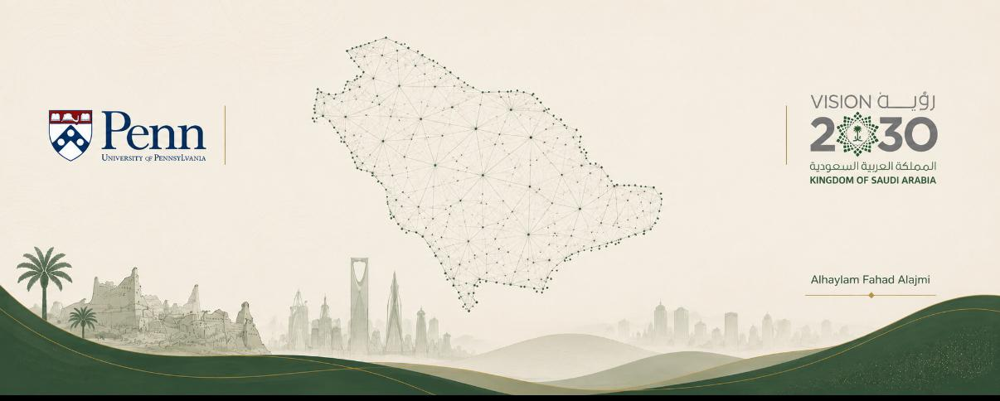
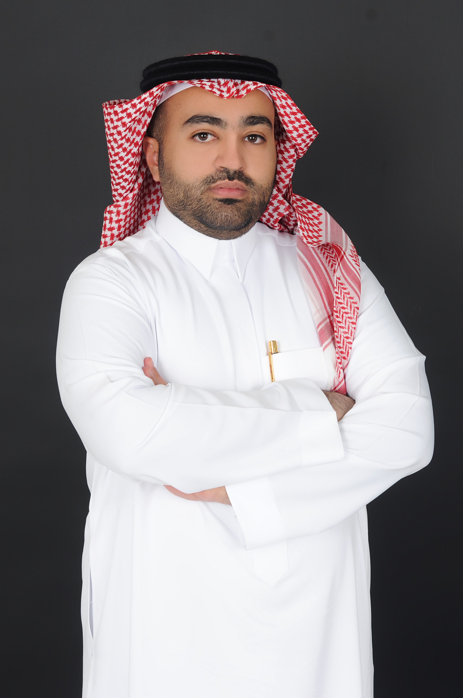

Cooling Riyadh

<section class="hero-section">

</section>

<section class="intro-grid">

<h2>Alhaylam Fahad Alajmi</h2>

Civil Engineer 
Urban Spatial Analytics Graduate Student

Civil engineer and graduate student in the
<strong>Master of Urban Spatial Analytics (MUSA)</strong>
program at the
<strong>University of Pennsylvania</strong>,
with approximately six years of professional experience across infrastructure,
urban development, project controls, and quality engineering projects in
Saudi Arabia.

  

Academic and professional interests include
<strong>smart cities, geospatial data science, urban analytics,
and AI-enabled urban decision-making</strong>.

Graduate Program

MUSA · University of Pennsylvania

Bachelor's Degree

B.S. Civil Engineering · Texas A&amp;M University

Professional Background

WSP · Green Riyadh 
Bechtel · NEOM

Certifications

PMP · PMI-RMP · P3O Foundation

Focus Areas

Smart Cities · GIS 
Urban Analytics · AI

Current Project

Cooling Riyadh

<h1>Cooling Riyadh</h1>

Mapping Urban Heat and Greening Priorities in Riyadh:
A Geospatial Data Science Approach

Cooling Riyadh is a geospatial data science project examining the spatial
relationship between urban heat, vegetation, population exposure, and the
built environment across Riyadh. The project integrates Landsat satellite
imagery, WorldPop population estimates, Microsoft Building Footprints, and
spatial clustering to identify areas that may warrant further evaluation for
urban greening interventions.

Landsat LST
NDVI
WorldPop
Building Footprints
K-Means
Priority Screening

<h3 class="glance-title">
Project at a Glance
</h3>

4
Core Data Sources

4,700
Analysis Grid Cells

5
Urban Cluster Profiles

500 m
Spatial Analysis Grid

</section>

