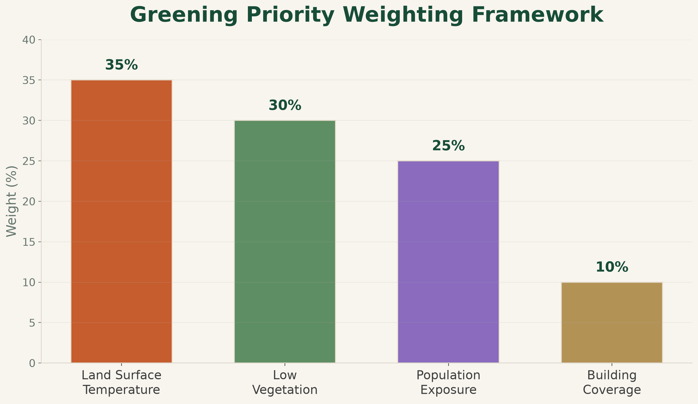

::: {.section-hero}

# Methods & Data

Cooling Riyadh integrates satellite imagery, population estimates, building footprints, and spatial machine learning within a common **500 m analysis grid**.

The workflow preserves the spatial meaning of each dataset while allowing multiple urban indicators to be compared consistently across Riyadh.

:::

::: {.methods-section}

## Data Sources

### Landsat Collection 2 Level-2

Used to derive **land surface temperature (LST)** and **NDVI**.

Surface reflectance and surface temperature products were processed with cloud and cloud-shadow masking before the Riyadh mosaics were created.

### WorldPop 2026

Used to estimate the spatial distribution of residents across Riyadh.

Population values were summarized into the 500 m analysis grid to provide an estimated population for each cell.

### Microsoft Building Footprints

Used to characterize the built environment.

Building polygons were clipped to Riyadh and summarized using building count, total building footprint area, and building coverage percentage.

### Riyadh Urban Boundary

The study area was defined using the Riyadh urban boundary extracted from the **Copernicus Global Human Settlement Layer Urban Centre Database**.

This boundary was used consistently for clipping, raster processing, and final visualization.

:::

::: {.methods-section}

## Analysis Workflow

01

Prepare Data

Clip, clean, and project the source datasets.

→

02

500 m Grid

Create a common spatial unit across Riyadh.

→

03

Urban Indicators

Calculate LST, NDVI, population, and building metrics.

→

04

K-Means

Identify recurring urban profiles using unsupervised machine learning.

→

05

Priority Score

Combine normalized indicators into a spatial screening score.

→

06

AI-Assisted Interpretation

Compare urban clusters with High and Very High priority areas.

:::

::: {.methods-section}

## Priority Score

The final greening priority score combines four normalized indicators.

35%
Land Surface Temperature

30%
Low Vegetation

25%
Population Exposure

10%
Building Coverage

These weights are **analyst-defined** and reflect the project's research question. They are not statistically estimated model coefficients and should be interpreted as a transparent spatial screening framework.

:::

::: {.methods-section}

## Machine Learning & AI

K-Means clustering was applied to four standardized variables:

**Land Surface Temperature · NDVI · Population · Building Coverage**

The algorithm grouped spatial cells according to similarity without using predefined labels.

The resulting urban profiles were then compared with High and Very High greening-priority cells to create the **AI-assisted priority interpretation**.

The machine-learning analysis supports interpretation of recurring urban conditions. It does **not** generate or replace the weighted greening priority score.

:::

::: {.methods-section}

## Important Limitations

<strong>Land Surface Temperature</strong> 
LST represents satellite-derived surface temperature rather than direct air temperature.

<strong>Vegetation</strong> 
NDVI indicates vegetation presence but does not distinguish individual trees from grass, shrubs, or other vegetation.

<strong>Population</strong> 
WorldPop provides modeled population estimates rather than direct census counts for every grid cell.

<strong>Buildings</strong> 
Building footprints describe mapped building geometry but do not directly represent height, occupancy, material, or land use.

<strong>Priority Weights</strong> 
The weighting scheme reflects the analytical objectives of this project and is not statistically optimized.

<strong>Intervention Readiness</strong> 
Priority areas identify locations for further assessment rather than direct planting recommendations.

Local land ownership, utilities, road geometry, water availability, existing projects, and planning constraints should be assessed before implementing any greening intervention.

:::